```{r setup, include=FALSE}
options(htmltools.dir.version = FALSE)
```

layout: true

<div class="unikn-footer"><span class="fbar-left">Session 1</span><span class="fbar-mid">Introduction to Social Data Science</span><span class="fbar-right">Winter Semester 2026/27</span></div>

---

# Today

1. Introduction to Social Data Science
1. The Parable of Google Flu Trends
1. Measuring Temporal Orientation with Google Trends

---
class: section, center, middle

# Introduction to Social Data Science

---

# What is the aim of Social Data Science?

> The aim of Social Data Science is   
**the Quantitative Understanding of Human Behavior**.  

- **Quantitative:** As opposed to qualitative or descriptive, we aim for robust findings grounded in strong evidence that can be quantified.  

- **Understanding:** Not just predicting, we want to be able to generalize and combine knowledge, and even to motivate interventions or policies.  

- **Human:**  We will not study particles or objects. Measurement validity and ethics will be a challenge.  

- **Behavior:** Observable changes, structures, dynamics, and patterns; not just stories or theories

---

#  How are we going to do it?
**Retrieving, processing, analyzing, and interpreting Digital traces.**  
<center>
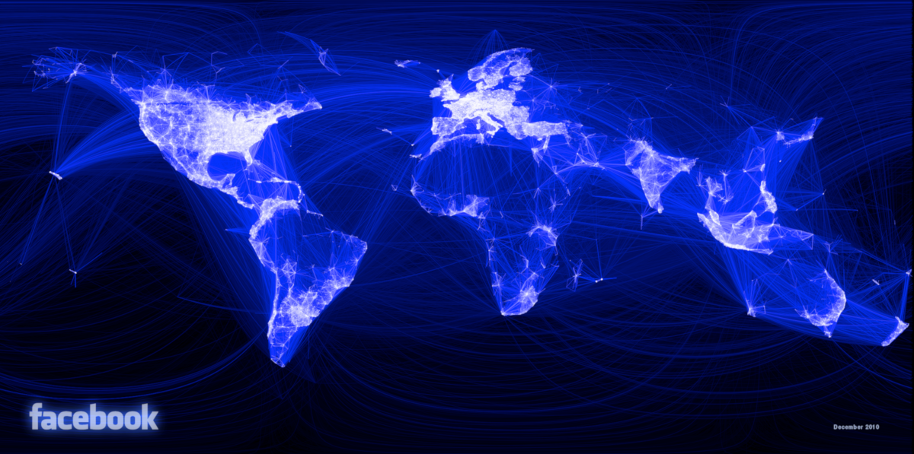
</center>
---

# Another example of digital traces
.pull-left[
**Pair up and guess together:** 

- What kind of traces are shown in the figure on the right?

- How were they collected?

- What can we learn about human behavior with this kind of data?

]
.pull-right[.center[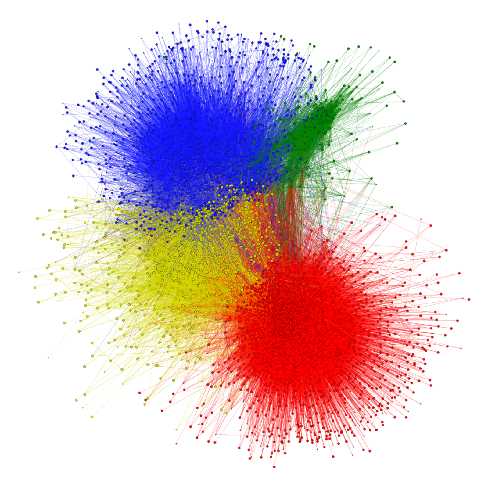]]

---

# What is data?

> **Data:** Facts in the form of stored and transmittable information.  

- *Data* is the plural of the Latin word *datum*. *Data* means “given (things)”.  
- Data is given to us, it is neither fabricated nor simulated.


---

# What is Social Data Science?

<div style="float:right">

</div>

**Data Science** is the application of methods from Computer Science and Statistics to empirical questions and practical problems.

**Social Data Science** is the application of Data Science to study human behavior and social interaction. 

- Importance of combining methods, synthesis, and communication
- Gathering digital traces with Computer Science techniques
- Interpretation of analyses with respect to what is known in the relevant Social Sciences
---

background-image: url(VennV2-1.svg)
background-size: 97%
---
background-image: url(VennV2.svg)
background-size: 97%
---


# Why digital traces?

Data from digital traces have six properties that can complement other traditional data sources in the social sciences:

- **Big Data:** Observing large amounts of humans across demographics  

- **Fast Data:** Quantifying aspects of human behavior in real time  

- **Long Data:** Retrieving longitudinal data and at various timescales  

- **Deep Data:** Gathering persistent information on individuals  

- **Mixed Data:** Combining heterogeneous data sources and unstructured data  

- **Strange Data:** Locating small subcommunities or deviant behavior  

---

# What are the limitations of digital traces?

With the great potential of digital traces also come great challenges:

- **Platform biases:** caused by their design, algorithms, social bots, etc

- **Data gatekeepers:** Not everyone can access some data sources

- **Performative behavior:** Talking online is not the same as offline.

- **Representativity issues:** Not everyone leaves digital traces. 

- **Observational data:** Testing causal mechanisms is not straightforward. 

- **The data deluge:** Too much data enables black-box predictions that can be useful but limit our understanding.

---


## The Hype Cycle of Social Data Science
<center>
```{r, echo=FALSE, out.width=900}
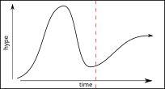
```

---

## The Hype Cycle of Social Data Science
<center>
```{r, echo=FALSE, out.width=900}
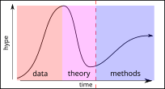
```

---


### The importance of questions in Social Data Science

  
Deep Thought, from the movie version of The Hitchhiker's Guide to the Galaxy.

> **Understanding our questions is a prerequisite to understanding their answers.**

---
class: section, center, middle

# The Parable of Google Flu Trends

### A Social Data Science Story

---

# Google Trends

Google Trends is a website hosted by Google that allows you to get a measurement of Google search volume for a term

<center>
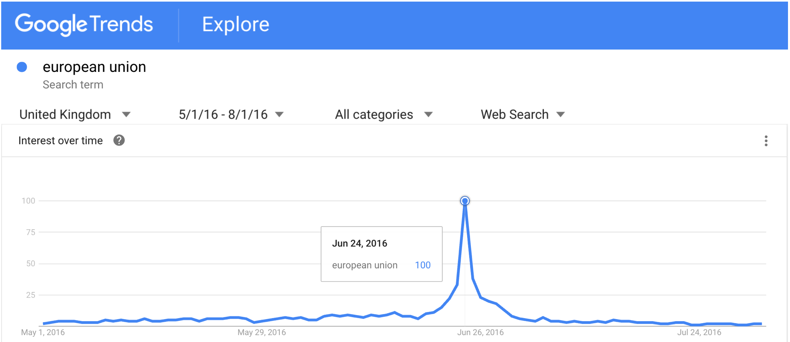  
</center>
---

## Nowcasting flu incidence with Google Trends

<div style="float:right">
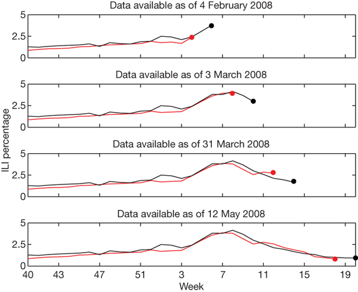  
</div>

**Nowcasting** is predicting the present. It provides an estimation of the value of a quantity based on signals that appear at the same time. 

Google Flu Trends aimed at nowcasting influenza-related physician visits based on Google search volumes. 

As reported in the [Nature paper](http://www.nature.com/nature/journal/v457/n7232/full/nature07634.html), Google Flu Trends achieved a high weekly accuracy between 2003 and 2008.

The figure shows the nowcasting result of Google flu trends. CDC data is published with a delay of two weeks.

---

## When Google Flu Trends Stopped working

<center>
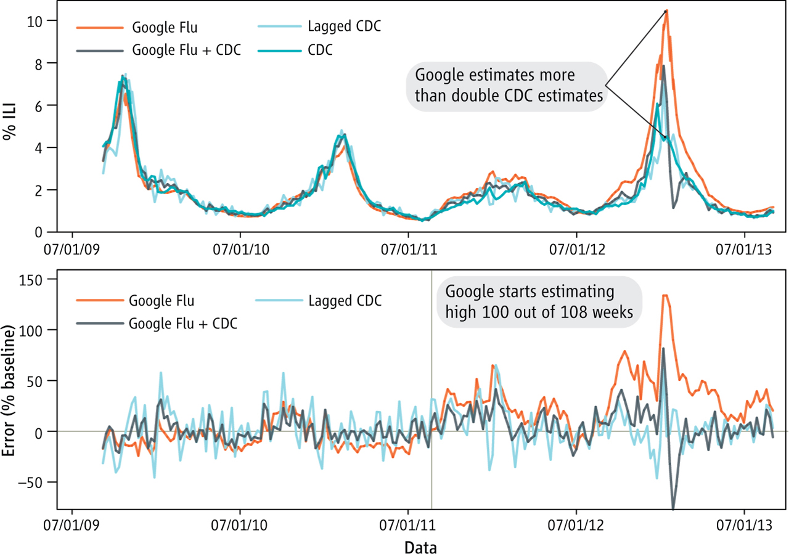  
</center>

---

## When Google Flu Trends Stopped working

In 2013, Google Flu Trends [started overestimating](https://www.nature.com/news/when-google-got-flu-wrong-1.12413) the incidence of flu cases.

A [follow-up study in Science](https://doi.org/10.1126/science.1248506) showed that just a lagged CDC prediction with 2 week-old data outperformed Google Flu Trends, without using any Google data.

Since many details about how Google and Google Trends work are not public, we cannot know for sure what the source of the error was. Some candidates are news-related searches, seasonal effects, or changes in Google's algorithm and interface.

Google Flu Trends is an example of **Big Data Hubris**: “The often implicit assumption that big data are a substitute for, rather than a supplement to, traditional data collection and analysis” [(Lazer et al, Science, 2014)](https://doi.org/10.1126/science.1248506)

> Take home message: **All data is better than Big Data**

---

## Beware of Making a Data Piñata

](Pinata.png)

Also known as kitchen-sink regression, garbage-in garbage-out, and post hoc storytelling. Some patterns will always come out with sufficient data, what matters is making sense of them.

---
class: section, center, middle

# Measuring Temporal Orientation with Google Trends

---

# Time, culture, and the economy

What is the relationship between culture and the economy?  

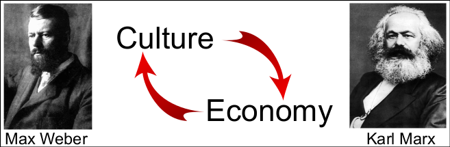

---

## Long-term orientation and economic development
> **Long-Term Orientation (Geert Hofstede)**  
Long-term oriented societies believe that the most important events in life will occur in the future; short-term oriented societies believe that those events occurred in the past or take place now.

.center[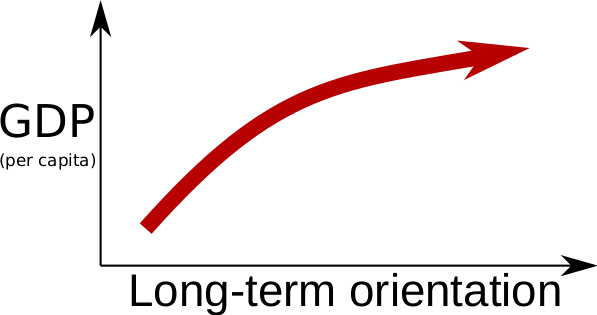]

---

## Measuring the Future Orientation Index

[Preis et al. 2012](https://www.nature.com/articles/srep00350) proposed a way to measure how much a society looks towards the future with Google Trends, the Future Orientation Index (FOI). The FOI for a country *c* in year *y* is calculated as:  

.center[
$FOI_{c,y} = \frac{G(y+1,y,c)}{G(y-1,y,c)}$
]

where $G(y_1,y_2,c)$ is the Google Trends volume for searches for year $y_1$ during year $y_2$ from country $c$. 

The FOI measures the ratio of search volume from a country for next year divided by the search volume for the previous year in the same country.

---

# Example of trends for FOI

.center[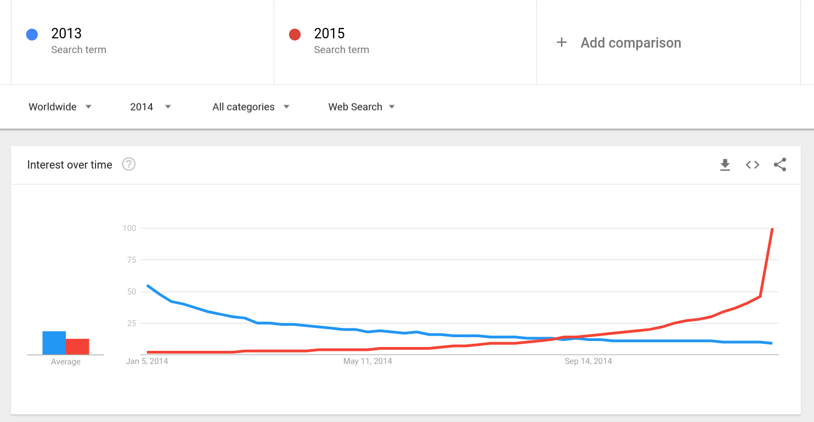]

---

# Example of trends for FOI
.center[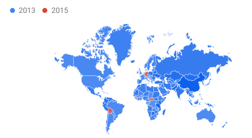]

---

# Exercise 1: Do richer countries look more to the future?

In [Exercise 1](../../Session03_RetrievingData/Exercise1/GDP_FOI_Short.html) (from Session 3), you will calculate the Future Orientation Index with Google Trends and test if it is still correlated with GDP per capita.

.source[[Preis et al. (2012)](https://doi.org/10.1038/srep00350), *Scientific Reports* 2:350. Images: CC BY-NC-SA 3.0]

.pull-left[
.center[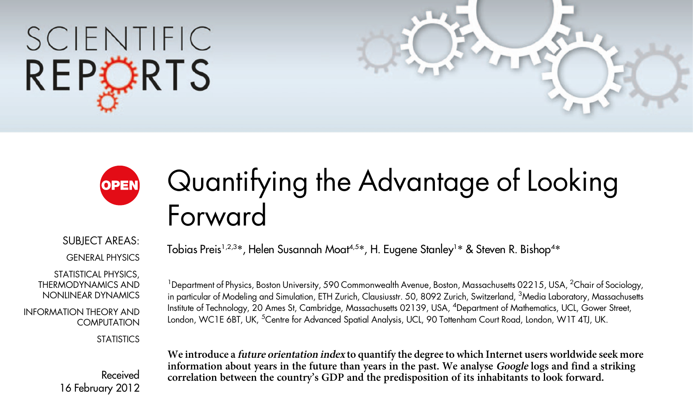]
]
.pull-right[
.center[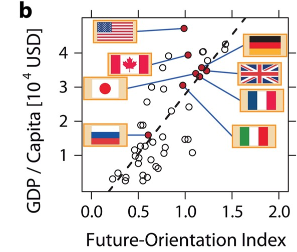]
]

---

# Homework before Session 2: install R and RStudio

Session 2 is an R crash course that starts directly with R, so please prepare your computer before it. It takes about 30 minutes. Follow the [setup instructions](../../setup/Setup.html):

1. Install **R** from <https://cloud.r-project.org/> (version 4.1 or newer)
2. Install **RStudio Desktop** from <https://posit.co/download/rstudio-desktop/>
3. Download the course materials and open `SDS_Intro_Konstanz.Rproj` in RStudio
4. Install the course packages: `source("setup/install_packages.R")`
5. Knit `setup/SetupCheck.Rmd`: it should end with "Everything is ready"

> **If something does not work:** use the **Posit Cloud** fallback described in the setup instructions. It runs all course materials in your browser, so you can follow Session 2 anyway.
