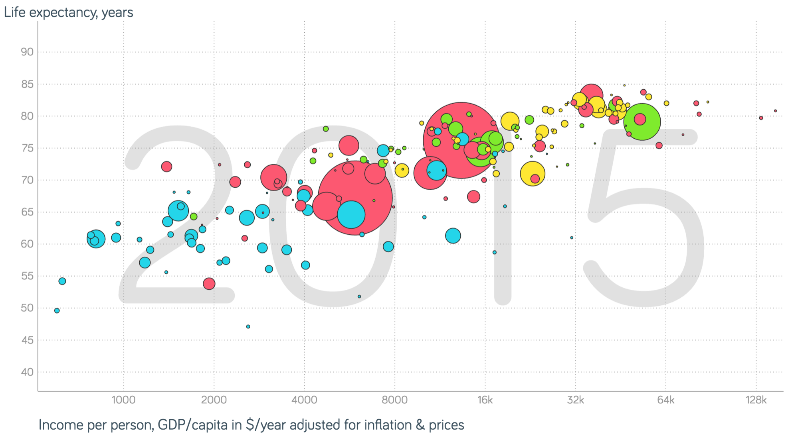
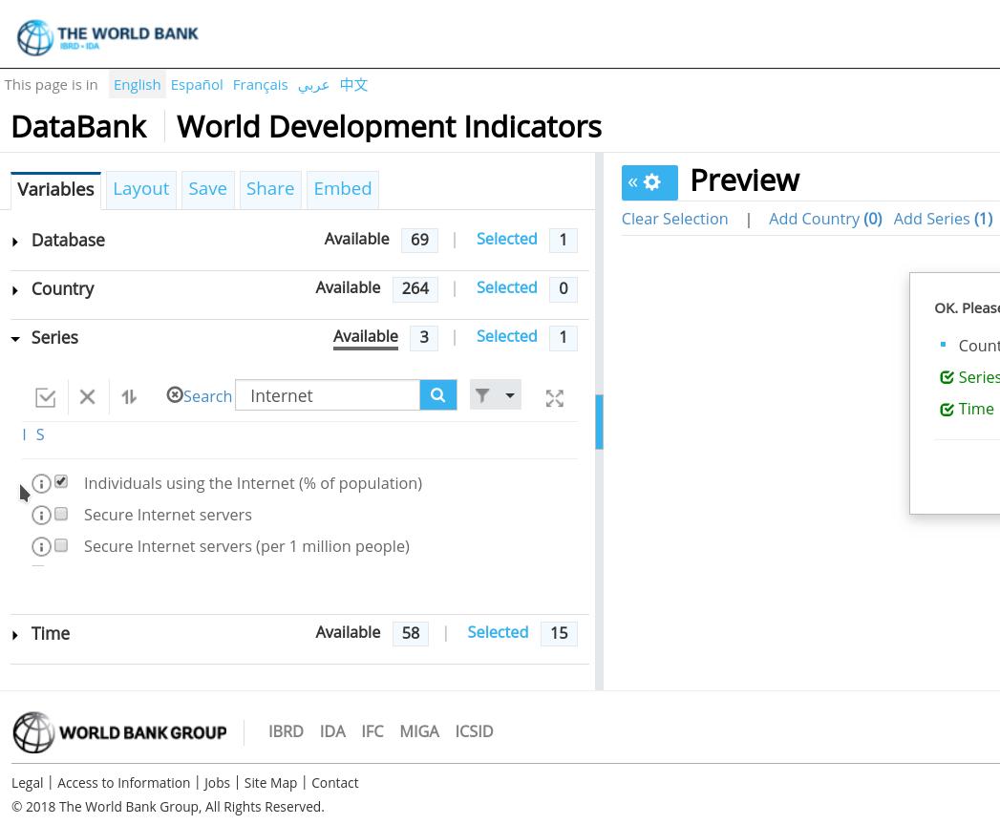
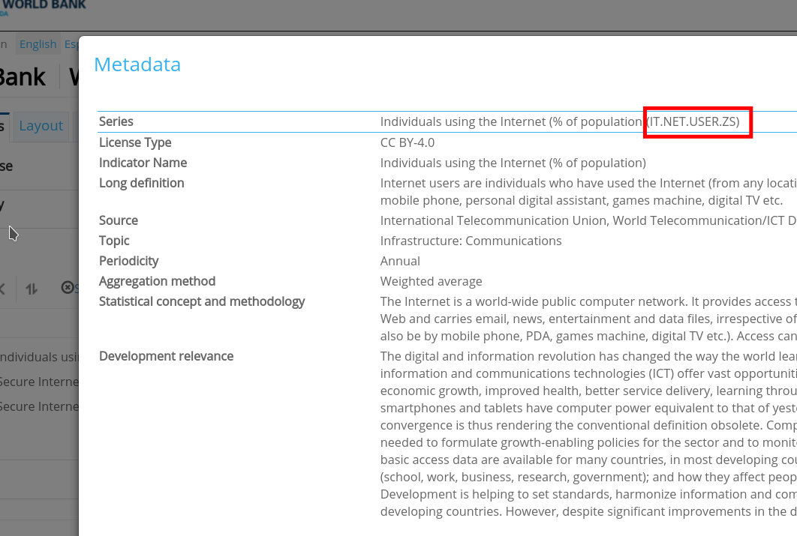
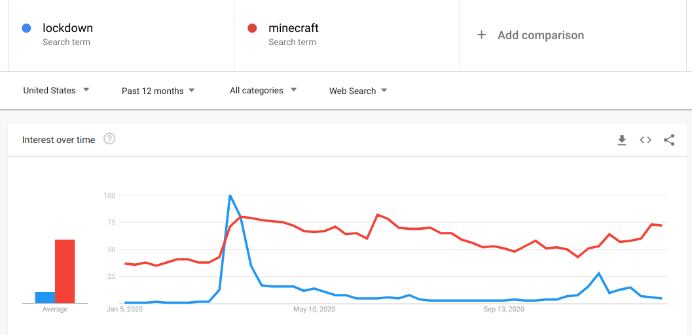
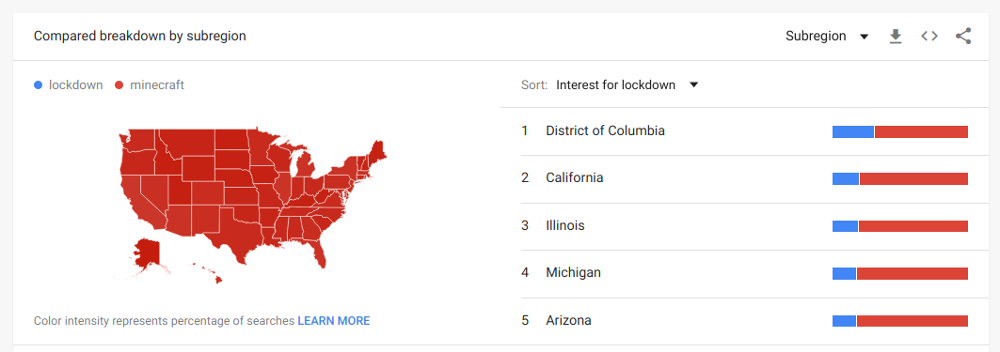
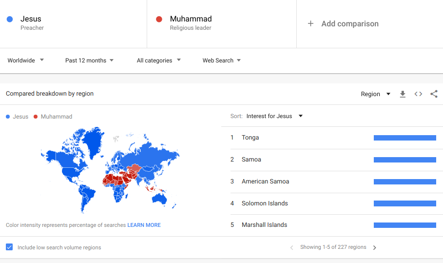

# Accessing the World Development Indicators from R

## The World Bank Development Indicators

The World Bank was founded in 1944 with the goal of reducing poverty in the world. It contains five agencies and almost every country is a member of the World Bank. One of its functions is to keep track of the economic development of many countries. [The World Development Indicators (WDI)](https://databank.worldbank.org/source/world-development-indicators) is a collection of data for different countries over as long a period as possible. You can explore the database through their [online interface](https://databank.worldbank.org/source/world-development-indicators).

This kind of development data can give great insights. You can find great examples of visualizations of development indicators at https://www.gapminder.org/tools/ like this one:



To know more, check Hans Rosling's talk ["The best stats you’ve ever seen."](https://www.ted.com/talks/hans_rosling_shows_the_best_stats_you_ve_ever_seen
)

## The WDI package

You can access the WDI database directly from R with [the WDI package](https://cran.r-project.org/web/packages/WDI/index.html). You can install it with the install.packages() function:

```{r eval=FALSE}
install.packages("WDI")
```

and load it with the library() function:
```{r p1-load}
library(WDI)
```

The package contains a function also called WDI() that you can use to query the database. You can find information about how the function works with the help command:
```{r}
?WDI
```

The most important parameters of WDI are the following:  
- indicator: id of the indicator in the database, see next section for more details.  
- country: country or list of countries for which you want data. You can leave it empty or say "all" to get all available countries and regions.  
- start and end: numbers of the years to cover with the request  
- extra: set it to TRUE if you want additional columns per country, like region, iso3 code, etc

For example, to get the GDP per capita with purchasing power correction for all countries between 2012 and 2014:
```{r}
df <-  WDI(indicator="NY.GDP.PCAP.PP.KD", country="all", start = 2012, end = 2014)
head(df)
```
The columns in the response depend on the query (e.g. extra=TRUE), but in general you get a column for the iso code of the region, the name, the value of the indicator, and the year.

## How to find an indicator

The WDI package has a function to search for the id of an indicator from R: WDIsearch(). You can put a term describing the indicator in the query and it will match it against fields of the description of the indicator in the database. For example for "GDP":

```{r}
results <- WDIsearch("GDP")
head(results)
```
This can be useful for some quick lookups for indicators you forgot the id for, but it is pretty limited if you are trying to find out the indicator for the first time. First, it just does a blind match without a relevance ranking, so sometimes you have huge result sets (e.g. for GDP you can get more than 500) and if you did not get the term right, you can easily have zero results. Second, the description for indicators is pretty poor, just from the short name it is hard to know how it is calculated, how many countries have that indicator available, for how many years, etc.

To search more carefully for indicators, you can do so at the [WDI online interface](https://databank.worldbank.org/source/world-development-indicators). Here the search is much smarter and you can find more information on each indicator. On the tab "Series" in the left menu, you can search for an indicator. For example, if you are searching for internet penetration:

{width=50%}

You can look up the detailed description of an indicator by clicking on the "i" button next to its name:

{width=50%}

I recommend that you take a look at the data on the WDI online interface to check that the countries you expect have the indicator. You can easily produce a plot with the time series of an indicator in a country or a table for you to take a closer look. Some indicators are repeated and might have worse coverage, so make sure you find the right one for your analysis!

## Some useful indicators

Finally, here's a list of indicators that I have found useful in previous work:

- NY.GDP.PCAP.PP.KD: GDP per capita in international USD, i.e. corrected for purchasing power  
- SP.POP.TOTL: Total population  
- IT.NET.USER.ZS: Internet penetration  
- SP.POP.TOTL.FE.ZS: % of female population
- SL.UEM.TOTL.NE.ZS: Unemployment as % of labor force  
- GB.XPD.RSDV.GD.ZS: Research & Development expenditure as % of GDP

# Google Trends data in R

## Exporting a Google Trends time series as csv

You can visit https://trends.google.com/ to make a query and download the data as csv. For example, if you query the terms "lockdown" and "minecraft", the first graph you see is this one:



The arrow button allows you to download a csv version of the data behind the plot. The first lines of the file will look approximately like this:

```
Category: All categories
   
Week,lockdown: (United States),minecraft: (United States)
2020-01-05,1,37
2020-01-12,1,36
2020-01-19,1,38
```

You might see the headers in another language if you are using a Google account with certain language settings.

We can read the data in R, but we want to ignore the first two lines of header. It is also a good practice to rename columns to something familiar:

```{r}
df <- read.csv("multiTimeline-lockdown.csv", skip=2)
names(df) <- c("week","lockdown","minecraft")
head(df)
```

And you can do your own plot of the time series to make sure that you loaded the data well.

```{r, fig.height=3}
plot(as.Date(df$week), df$lockdown, type="l", col="blue", 
     lwd=2, ylab="volume", xlab="date")
lines(as.Date(df$week), df$minecraft, col="red", lwd=2)
```

## Exporting a Google Trends map as csv

Below the time series plot, Google Trends offers a map comparing regions. The above query was for the US, but you can configure it for the whole world or for another country or area:



Clicking on the same download symbol, you will download a file that looks like this:  
```
Category: All categories

Region,lockdown: (1/3/20 - 1/3/21),minecraft: (1/3/20 - 1/3/21)
Utah,8%,92%
Alaska,6%,94%
Idaho,8%,92%
```

Same as before, you can read it ignoring the first two lines and renaming the columns. 

```{r}
geodf <- read.csv("geoMap-lockdown.csv", skip=2)
names(geodf) <- c("region","lockdown","minecraft")
head(geodf)
```

Those percentage signs are a problem. The fractions are read as character strings rather than as numeric. We can convert them by removing the percentage sign and converting to numeric like this:

```{r}
geodf$lockdown <- as.numeric(gsub("%", "", geodf$lockdown))
geodf$minecraft <- as.numeric(gsub("%", "", geodf$minecraft))
head(geodf)
```

## The gtrendsR package

The [gtrendsR package](https://cran.r-project.org/web/packages/gtrendsR/index.html) provides a way to access Google Trends from R. It is useful to make searches reproducible, but **do not make many calls in a short period of time because Google will block you.** Always save the data as soon as you get it.

You can install the package like other packages (it is also included in `setup/install_packages.R`):
```{r, eval=F}
install.packages("gtrendsR")
```

Google changes its Trends interface from time to time, and then the package stops working until a new version is released. If `gtrends()` gives errors other than "429" (which means that Google blocked you for making too many queries; wait a while), try the latest development version from GitHub:
```{r, eval=F}
install.packages("remotes")
remotes::install_github("PMassicotte/gtrendsR")
```

And loading it as well:
```{r}
library(gtrendsR)
```

Its main function is called gtrends, which allows you to query Google Trends automatically. Take a look at the documentation of the function with this command:
```{r}
?gtrends
```

Among its parameters, four are important for us:

- keyword: term or terms to query  
- geo: identifier of the regions to cover with the query  
- time: a time identifier as in Google Trends URLs, see the help  
- low_search_volume: should be set to TRUE if you want to include small countries  

For example, we can search for the terms "2013" and "2015" from all over the world including low search volume regions and on the year 2014:
```{r}
result <- gtrends(keyword = c("2013","2015"), geo = "", time="2014-01-01 2014-12-31", low_search_volume = T)
```

The result is an object with various data frames. For example, interest_over_time contains the time series with the volume on its column "hits":
```{r}
head(result$interest_over_time)
```
 
And interest_by_country contains the volume across countries:
```{r}
head(result$interest_by_country)
```

## Appendix: Disambiguated trends

On Google Trends you can also search for freebase entries. This way, Google disambiguates and translates search terms, mapping them to entry terms like "Zürich (city in Switzerland)" to the code "/m/08966". You can see the freebase entry for Zurich at [this archived copy](https://web.archive.org/web/20211020073944/https://freebase.toolforge.org/m/08966). You can do the same for any code, appending it at the end of https://freebase.toolforge.org <span style="color:red;font-weight:bold">[Note: this Freebase mirror is offline (HTTP 503)]</span> to see what the database entry refers to.

For example, you can search for terms across languages like this:



Here, "Jesus" has been disambiguated to the id "/m/045m1_" and "Mohammad" to the id "/m/04s9n". Google Trends shows the volume aggregated for queries including the ways to say both words in other languages.

And you can use the freebase ids  in gtrendsR to get the data directly:

```{r}
result <- gtrends(keyword = c("/m/045m1_","/m/04s9n"), low_search_volume = T)
head(result$interest_by_country)
```
