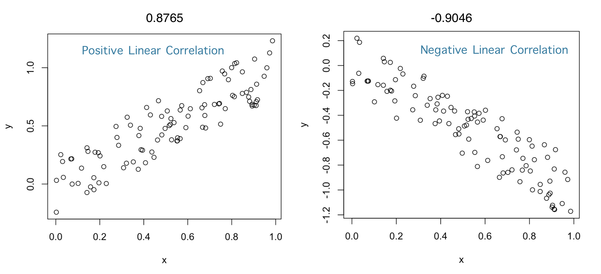
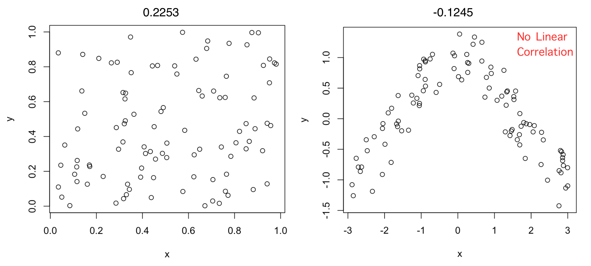
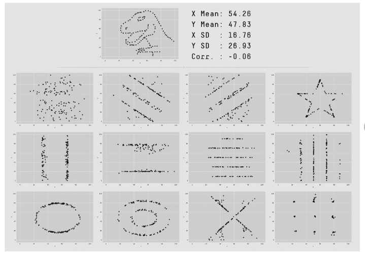

```{r setup, include=FALSE}
options(htmltools.dir.version = FALSE)
```

layout: true

<div class="unikn-footer"><span class="fbar-left">Session 3</span><span class="fbar-mid">Introduction to Social Data Science</span><span class="fbar-right">Winter Semester 2026/27</span></div>


---
class: section, center, middle

# Correlation and Linear Regression

---

# Some univariate statistics notation


- $X$ is a random variable
  - In data: $X_i$ is the value of the variable for entry $i$
  - For example the GDP of a country

- $E[X]$ is the expected value of $X$
  - We estimate the expected value as the mean of $X$: 
  $$\mu_X = \frac{1}{N}\sum_i X_i$$
  - $N$ is the number of data points, for example the number of countries

---

# Some more univariate statistics notation

- $V[X]$ is the variance of $X$
  - We calculate it as the expected squared difference from the mean of $X$: 
  $$V[X] = \frac{1}{N}\sum_i (X_i - \mu_X)^2$$
  - It is measured in squared units of $X$

- $\sigma_X$ is the standard deviation of X
  -  $\sigma_X = \sqrt{V[X]}$, which is convenient because it measures dispersion in the same units as $X$
  - in R you can calculate it with the function sd()

---

## Pearson's Correlation Coefficient $\rho(X,Y)$

> **Correlation:** Linear association or dependence between the values of variables $X$ and $Y$
 
- If $X$ and $Y$ are independent, they satisfy that the expectation of the product equals the product of expectations:  
$$E[XY] = E[X]E[Y]$$  
- The principle: correlation as the deviation from $E[XY] − E [X]E[Y] = 0$  
- The absolute value of this difference can be at most $\sigma_X\sigma_Y$  
- $\rho(X,Y)$ rescales the difference to be between −1 and 1  

$$\rho(X,Y) = \frac{E[XY] − E [X]E[Y]}{\sigma_X\sigma_Y}$$
---

### Some examples of Pearson's Correlation Coefficient


---



Independent variables will have a correlation close to zero, but a correlation close to zero does not mean independence
---

## Anscombe's quartet  ( $\rho=0.816$ )

.center[]
---

## The Datasaurus dozen
.center[]

---

# Linear Regression

Regression models formalize an equation in which one numeric variable $Y$ is formulated as a linear function of other variables $X_1$, $X_2$, $X_3$, etc: <center>
$Y = a + b_1 X_1 + b_2 X_2 + b_3 X_3 ... + \epsilon$
</center>
- $Y$ is called the dependent variable

- $X_1$, $X_2$, $X_3$, etc are called independent variables

- $a$ is the intercept, which measures the expected value of $Y$ that does not depend on the independent variables

- $b_1$, $b_2$, $b_3$, etc are called the slopes or the coefficients

- $\epsilon$ are the residuals, the errors of the equation in the data

---

# Example: FOI vs GDP

```{r echo=F, message=F, results='hide', fig.width=9, fig.align='center'}
library(dplyr)
df <- read.csv("FOI.csv")
df$GDP <- df$NY.GDP.PCAP.PP.KD
df %>% filter(SP.POP.TOTL*IT.NET.USER.ZS/100 > 5000000) -> df
model <- lm(GDP~FOI, df)
par(mar=c(4,5,0,0))
plot(df$FOI, df$GDP, xlab="FOI", ylab="GDP per capita", cex.axis=2, cex.lab=2)
abline(model$coefficients[1], model$coefficients[2], col="red")
```

---

# Regression residuals

Residuals ( $\epsilon$ ) are the differences between the empirical values $Y_i$ and their fitted values $\hat Y_i$.
```{r echo=F, message=F, results='hide', fig.width=10, fig.height=6, fig.align='center'}
library(dplyr)
par(mar=c(4,5,0,0))
plot(df$FOI, df$GDP, xlab="FOI", ylab="GDP per capita", cex.axis=2, cex.lab=2)
abline(model$coefficients[1], model$coefficients[2], col="red")
segments(df$FOI,model$fitted.values, df$FOI,df$GDP, col="darkgreen")
```

---

# Ordinary Least Squares (OLS)

**Fitting** a regression model is the task of finding the values of the coefficients ( $a$, $b_1$, $b_2$, etc ) in a way that minimizes an aggregate measure of the residuals of the model. One approach is called Residual Sum of Squares (RSS), which aggregates residuals as:

<center>
$RSS = \sum_i (\hat Y_i - Y_i)^2$
</center>  
The Ordinary Least Squares method (OLS) looks for the values of coefficients that minimize the RSS. This way, you can think about the OLS result as the line that minimizes the sum of squared lengths of the vertical lines in the figure above.

---

# Regression in R

The lm() function in R fits a linear regression model with OLS. You have to specify the *formula* of your regression model. For the case of one independent variable, a formula reads like this:  
```{r eval=F}
DependentVariable ∼ IndependentVariable
```
If you print the result of lm(), you will see the best fitting values for the coefficients (intercept and slope):

```{r message=F}
model <- lm(GDP~FOI, df)
model$coefficients
```

---

# Goodness of fit

A way to measure the quality of a model fit is to calculate the proportion of variance of the dependent variable ( $V[Y]$ ) that is explained by the model. We can do this by comparing the variance of residuals ( $V[\epsilon]$ ) to the variance of $Y$. 

This is captured by the coefficient of determination, also known as $R^2$:
<center>
$R^2 = 1 − \frac{V[\epsilon]}{V[Y]}$
</center>  
For our model example:
```{r }
1-var(residuals(model))/var(df$GDP)
```

---

# Multiple regression

You can specify models with more than one independent variable by using "+":
```{r eval=F}
DependentVariable ∼ IndependentVariable1 + IndependentVariable2 + IndependentVariable3
```
If we wanted to fit a model of GDP as a linear combination of the FOI and the internet penetration in countries, we can do it as follows:
```{r message=F}
model2 <- lm(GDP~FOI+IT.NET.USER.ZS, df)
model2$coefficients
summary(model2)$r.squared
```

---

# Regression diagnostics

```{r fig.width=9, fig.height=6, fig.align="center"}
hist(residuals(model), main="", cex.lab=1.5, cex.axis=2)
```

---

# Regression diagnostics

```{r fig.width=9, fig.height=6, fig.align="center"}
plot(predict(model), residuals(model), cex.lab=1.5, cex.axis=2)
```

---

<center>

</center>
