```{r setup, include=FALSE}
options(htmltools.dir.version = FALSE)
```

layout: true

<div class="unikn-footer"><span class="fbar-left">Session 4</span><span class="fbar-mid">Introduction to Social Data Science</span><span class="fbar-right">Winter Semester 2026/27</span></div>

---

# Today

1. Social Impact Theory
1. The Simmel Effect
1. Data Science of Baby Name Data

---
class: section, center, middle

# Social Impact Theory

---

# What is Social Impact?

<div style="float:right">
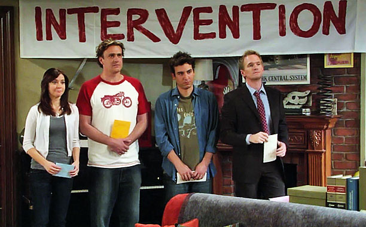  
</div>

> **Social Impact:** Changes in behavior that occur in an individual as a result of the presence or actions of other individuals

Examples of behavior: subjective feelings, motives, emotions, thoughts, customs, decisions...  

The presence or actions of others can be:  

- *real:* the physical presence of others  
- *implied:* expected or manipulated presence, e.g. a cardboard policeman  
- *imagined:* mental representation of others, e.g. supporters of your team when watching TV sports

---


# The case of conformity


.pull-left[**Pair up and discuss:**

- What do you expect from one person entering an elevator with two people inside looking away from the door?
- What would be different if there is only one person inside?
- And if there are four people inside the same way?
- What would be different if two people enter together and four are inside looking away?
]

.pull-right[


]
---


# Asch's conformity experiments


Elevator experiment in Candid Camera (1962)

---

# Social Impact Theory (Bibb Latané)
<center>
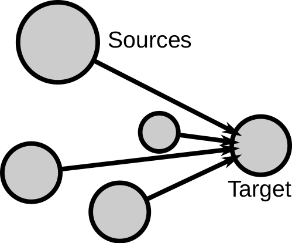
</center>

---

# Social forces in SIT

In [Social Impact Theory](http://psycnet.apa.org/psycinfo/1982-01296-001), social impact is driven by three forces in the following equation:
$$I = f (S × i × N)$$

- $I$ is the magnitude of social impact

- $f()$ is a multiplicative function of three conditions of the impacting situation:

  1. **Strength** $S$ or power of the source(s)  

  2. **Immediacy** $i$ or proximity of the source(s)

  3. **Number of sources** $N$ or number of people

---

# N: Number of sources

<div style="float:right">
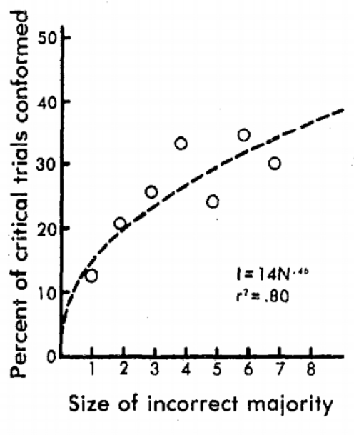  </div>
</br>
</br>
SIT predicts that impact should grow with N. Asch's conformity experiments test this hypothesis, where:

- $I$: increase in percentage of wrong answers given by students that were experiment subjects

- $N$: controlled number of confederates

The result: the percentage of wrong answers grows with the number of sources.

---

# The Psychosocial Law

<div style="float:right">
  </div>

> **The Psychosocial Law:** The extent of social impact grows sublinearly with the number of sources  

This can be translated to the equation:
$$I \propto N^t, t < 1$$

This means that the hundredth source has less additional effect than the first (*diminishing returns*).

The equation is what is called a power-law with exponent $t$. In the case of conformity among high school students, $t$ was estimated to be 0.48.

---

# S: Strength of sources

<div style="float:right">
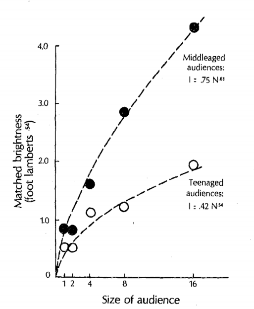
</div>

The strength in SIT is the perceived social status, power, wealth, importance, or intensity of the sources. Poem experiment example:

- $I$: anxiety of the students recorded with a dial they use to measure their own anxiety

- $N$: number of people in the audience

- $S$: audience is middle-aged (strong) or teenagers (weak)

**Multiplicative effect:** The impact of the number of sources grows faster when they are strong than when they are weak

---

# i: Immediacy of sources

<div style="float:right">
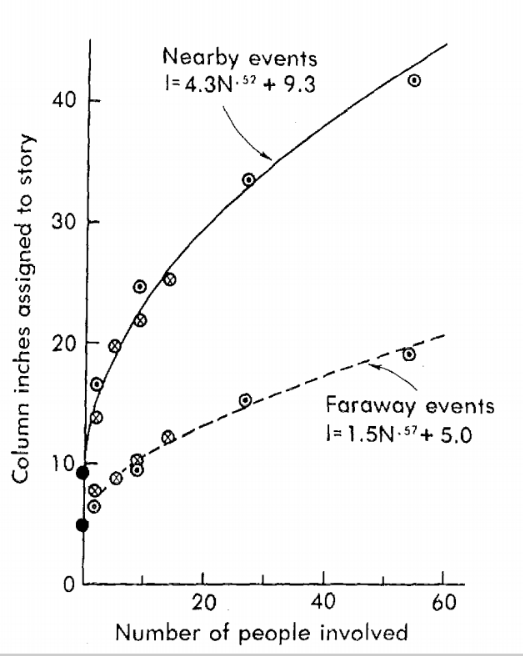  
</div>

Immediacy is defined as the proximity between the sources and the target of social impact. Immediacy can be spatial, temporal, or social.
The effect of immediacy in media bias experiments: 
- $I$: number of lines used to report the news by the students
- $N$: number of people reported dead in the accident
- $i$: the distance to the place of the accident (close vs far conditions)

Results: The growth of impact with N was steeper for the close condition

---

# Division of impact
<center>
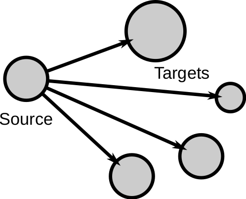
</center>
---

# Division of impact

Social Impact Theory also covers situations with one source but when targets are not alone. It formulates the impact $I$ on **each** target as:  
$$I = f\left(\frac{1}{S × i × N}\right)$$ Where the terms are:  
- $S$ strength of the targets: the stronger the targets, the harder to impact each one.  
- $i$ immediacy between the targets: the closer or more connected the targets, the harder to impact each one.  
- $N$ the more the targets in the group, the harder to impact each one.
- $f()$ is a multiplicative function with negative exponents for the terms.

---

# Division of impact

<div style="float:right">
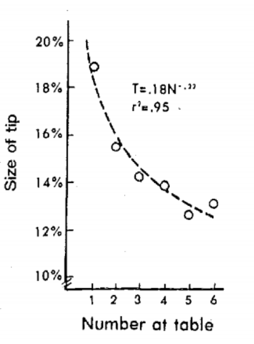
</div>

The most widely studied divisor of impact is group size (N). An observational study finds the effect for the case of restaurant tips:

- $I$: Percentage of tip (assumed evenly shared among customers)
- $N$: number of customers at the table

Result: $I$ decreases as $N$ increases. The more people sitting at the same table, the less obliged each one feels to leave a tip. The resulting shape of I as a function of N is well fitted by a negative power of N. 

---

# Online social impact: the data

The next slide shows the *exposure response function*: the probability to adopt a piece of information after $k$ friends adopted it, averaged over all users.

.pull-left[
 **Digg** ([Ver Steeg, Ghosh & Lerman, 2011](https://arxiv.org/abs/1102.1985))

- 3,553 front page stories, June 2009 (Digg API)
- Votes of 139,409 active users
- Fan network: 279,634 users, 1.7 million links
- Adoption: digging a story after $k$ friends dugg it
]

.pull-right[
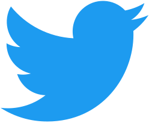 **Twitter** ([Hodas & Lerman, 2012](https://arxiv.org/abs/1205.2736))

- Tweets with URLs, three weeks in fall 2010
- Without spam and bots: 2,072 URLs, 1.3 million retweets by 487,000 users
- Follower graph of almost 700,000 users
- Adoption: retweeting a URL after $k$ friends tweeted it
]

---

# Online social impact

The psychosocial law can be observed in various social media:
<center>
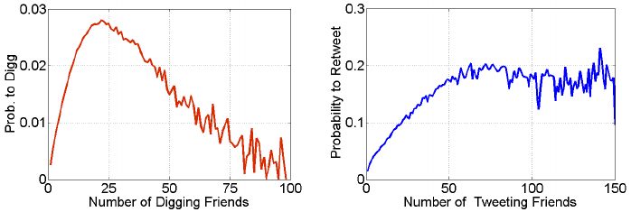
</center>
Probability to Digg or Retweet as a function of number of friends who already did so. Taken from Kristina Lerman's review ["Information Is Not a Virus, and Other Consequences of Human Cognitive Limits"](https://doi.org/10.3390/fi8020021). 

---
class: section, center, middle

# The Simmel Effect

---

## How does social impact aggregate in a society?

.center[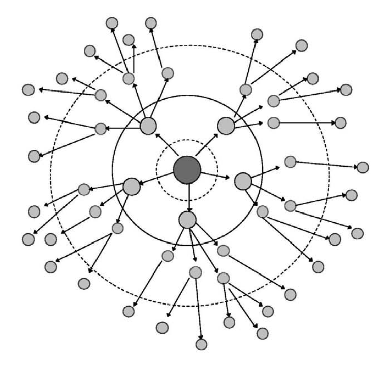]

---

# Theory of fashion: the Simmel Effect

Georg Simmel defined fashion as the *non-cumulative change in cultural features*, where cultural features are displayed as *status symbols*. Status symbols are externally displayed traits associated with high social class, e.g. surnames, clothing, sport, food, etc.

> **The Simmel effect:** The persistence of social differences under the instability of status symbols

Simmel noticed that fashions come and go, but fashion is always present. When something becomes popular, it is bound to lose its popularity. Simmel introduced this theory in his 1904 article ["Fashion"](https://www.jstor.org/stable/2773129?seq=1), describing observations that are still relevant, such as how going against fashion is a way to acknowledge its relevance (the hipster paradox).

---

## The mechanisms of Simmel's theory: </br> Imitation

.center[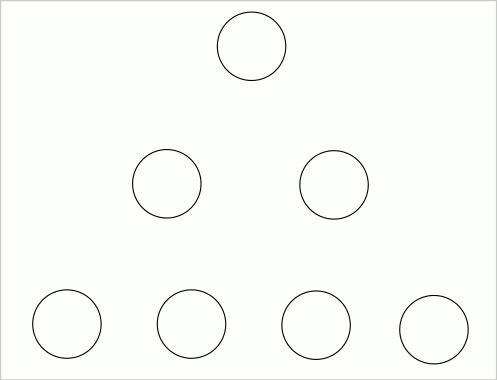]

---

## The mechanisms of Simmel's theory: Differentiation

.center[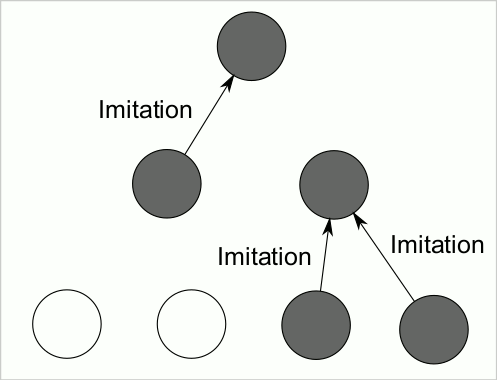]
---

.center[]
---

# Social trends in online platforms

Google search trends can capture data about these large-scale social trends:

.center[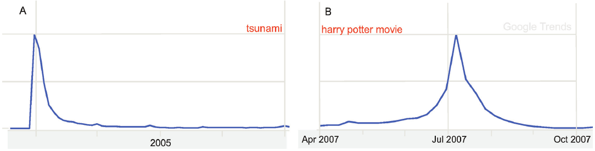]

Exogenously triggered search volume after a tsunami (left) and endogenously driven search for the Harry Potter movie (right).

---

# The data: views of YouTube videos

[Crane and Sornette (2008)](https://doi.org/10.1073/pnas.0803685105) tested their model with YouTube:

- Time series of daily views of nearly **5 million videos**, collected several times a day over 8 months
- Views come at random, exogenously (video is featured) or endogenously (video is shared)
- About 90% of videos have little activity or look like a random process: *endogenous sub-critical*
- The other 10% (about 500,000 videos) have bursts. They are classified by the fraction $F$ of their views on the peak day:
  - $F \geq 80\%$: *exogenous sub-critical*
  - $20\% < F < 80\%$: *exogenous critical*
  - $F \leq 20\%$: *endogenous critical*
- After the peak, views decay as a power law $1/t^p$. The exponents of the three classes cluster around $p \approx 1.4$, $0.6$ and $0.2$, as the model predicts

---

# The endo-exo model

<div style="float:right">
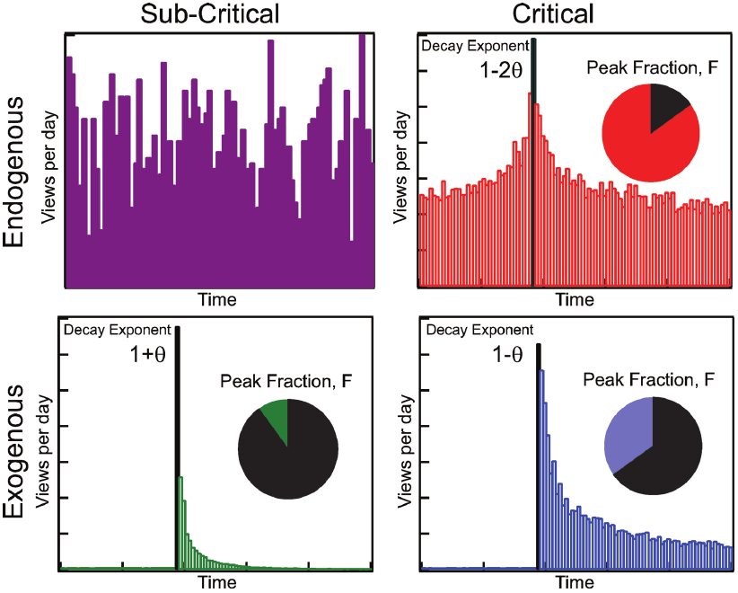
</div>

[The endo-exo model of Riley Crane and Didier Sornette](https://doi.org/10.1073/pnas.0803685105) captures these types of dynamics. In this model, a trend can have two properties:  

- It can have an **exogenous trigger** when a central event influences lots of people at the same time, as in the tsunami example.
- It can be **critical** when the social interaction between individuals leads to further responses and it is stronger than the rate of losing interest.

---

# The endo-exo model

<div style="float:right">

</div>

These two properties are not exclusive, leading to four types of responses:  

1. **Endogenous sub-critical**: no clear peak, absence of trend.
2. **Endogenous critical**: "viral" peak driven by word of mouth.
3. **Exogenous sub-critical**: sharp peak but fast decay due to lack of strong social interaction.
4. **Exogenous critical**: sharp peak but slow decay due to strong interaction after shock.

---

# Trends on Twitter: data and setup

[Lehmann et al. (2012)](https://doi.org/10.1145/2187836.2187871) studied the popularity of Twitter hashtags:

- About 130 million tweets by 6.1 million users, from November 2008 to May 2009, plus the follower network of 2.7 million users
- Popular hashtags: used by at least 500 different users (402 of about 400,000 hashtags)
- Daily number of tweets of each hashtag. A day is a peak when its activity is more than 10 times above the median of the 61 days around it. Only hashtags with an isolated peak are kept: 115 hashtags
- In the two weeks around the peak, each hashtag is summarized by the fractions of its tweets **before** ($f_b$), **on** ($f_p$) and **after** ($f_a$) the peak day
- A clustering algorithm (Gaussian mixture model) finds **four classes** of hashtags in this space

---

# What trend class is this Twitter trend?
.center[
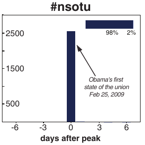]
---

# What trend class is this Twitter trend?
.center[
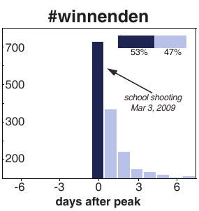]
---

# What trend class is this Twitter trend?
.center[
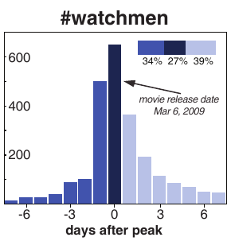]
---

# What trend class is this Twitter trend?
.center[
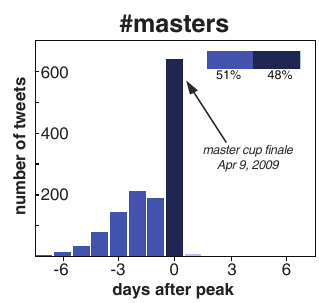]
---


# Trends on Twitter

This model has been applied to classify Twitter hashtag trends by [Lehmann et al](https://doi.org/10.1145/2187836.2187871). 

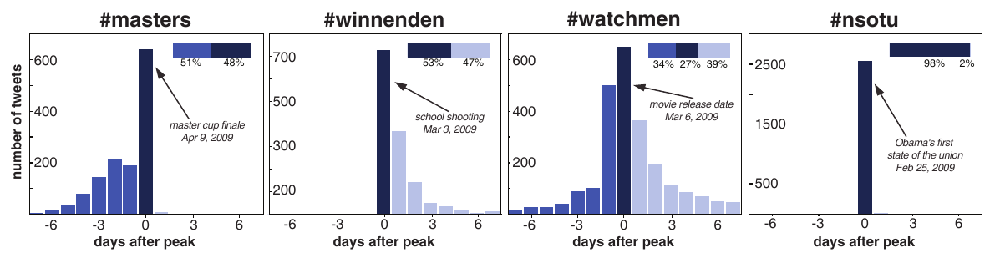
- The case of #winnenden is exo-critical, the case of #watchmen is endo-critical, the case of #sotu is exo-subcritical
- The case of the #masters hashtag is an anticipatory trend that does not fit the endo-exo classification.

---

# Anticipated shocks

[Stommel et al. (2016)](https://doi.org/10.1145/2908131.2908191) looked for anticipatory trends like #masters on YouTube:

.pull-left[
- Daily views and shares of over 50,000 videos (at least 100 shares and 500 days of data)
- Activity before, at and after the peak, as in Lehmann et al.
- New class V, **anticipated shock**: at least 10% before and less than 10% after the peak (e.g. Earth Hour). Rare: 0.5% of videos
- 2.37 times more frequent in shares (word of mouth) than in views (attention)
]

.pull-right[
.center[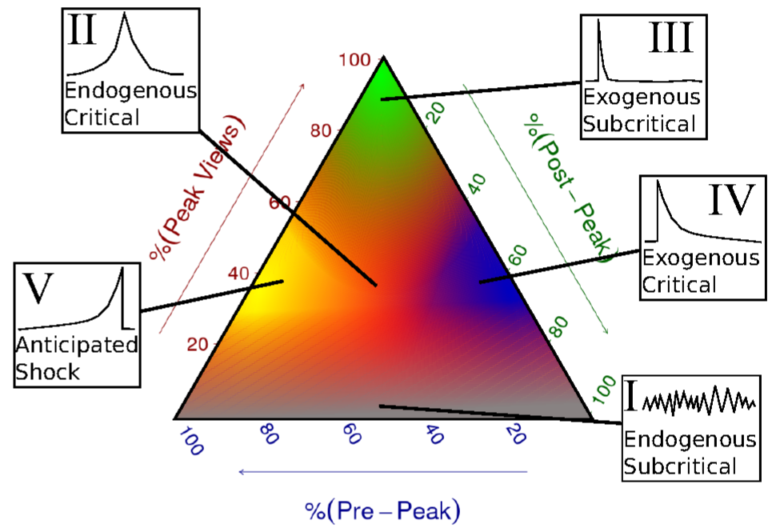]
]

---
class: section, center, middle

# Data Science of Baby Name Data

---

# The case of baby names
.center[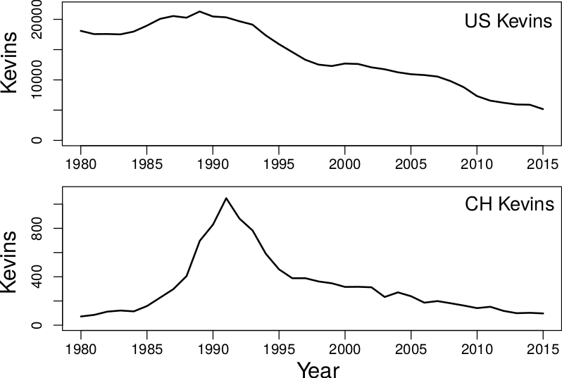]
First names can be status symbols and carry subjective and social values. Copying the name of your baby from someone else is an example of imitation.

---

# US SSA baby name data
```{r, message=F, results='hide', fig.width=14, fig.height=6.5, echo=F, cache=T, fig.align='center'}
# You can read the data without decompressing it using the gzfile function. 
library(dplyr)
df <- read.csv(gzfile("BabyData2019.csv.gz"))
df %>% group_by(year) %>% summarize(nbabies=sum(count)) -> total
par(mar=c(4.5,4.5,0,0))
plot(total, ylab="babies", type="l", lwd=2, cex.lab=2, cex.axis=2)
```
---

# Baby name trend examples

```{r, message=F, results='hide', fig.width=14, fig.height=6.5, echo=F, cache=T, fig.align='center'}
name1 <- "Angelina"
name2 <- "Leonardo"
df %>% filter(name==name1 & year>=1940) %>% group_by(year) %>% summarize(nbabies=sum(count)) -> total
par(mar=c(4.5,4.5,0,0))
plot(total, ylab="babies", type="l", lwd=2, cex.lab=2, cex.axis=2)
df %>% filter(name==name2 & year>=1940) %>% group_by(year) %>% summarize(nbabies=sum(count)) -> total
lines(total, lwd=2, col="red")
legend("topleft",legend=c(name1, name2), col=c("black","red"), lwd=2, cex=3)
```


---

# The QWERTY effect in baby names

The QWERTY effect is a hypothesis in Psychology that postulates that words that are written with more right-hand letters of the keyboard are, on average, more positive than words that are written with more left-hand letters of the keyboard. The fraction of right-hand letters in US baby names has been increasing:
```{r, message=F, results='hide', fig.width=14, fig.height=5, echo=F, cache=T, fig.align='center'}
library(stringr)
df %>% group_by(name,year) %>% summarize(count=sum(count)) %>% filter(year>1960)-> ngdf

df$R <- str_count(pattern='[yuiophjklnm]',tolower(df$name))
df$L <- str_count(pattern='[qwertasdfgzxcvb]',tolower(df$name))

df %>% group_by(year) %>% summarize(RSA = sum(count *(R-L)), n=sum(count)) %>% filter(year>=1960)-> RSAdf
par(mar=c(4.5,4.5,1.5,0))
plot(RSAdf$year, RSAdf$RSA/RSAdf$n, type="l", lwd=2, xlab="year", ylab="mean RSA", cex.lab=2, cex.axis=2)
```
---

# Wacky baby name research

```{r, message=F, results='hide', fig.width=14, fig.height=5.5, echo=F, cache=T, fig.align='center'}
tempdf <- read.csv("https://www.epa.gov/sites/production/files/2016-08/temperature_fig-1.csv", skip=6)

df %>% filter(year>=1937) %>% group_by(year,gender) %>% summarize (nnames=n()) -> udf
sdf <- inner_join(udf, tempdf, by=c("year"="Year"))
par(mar=c(4.5,4.5,1.5,0))

plot(sdf$Earth.s.surface[sdf$gender=="M"], sdf$nnames[sdf$gender=="M"], col="lightblue", pch=19, xlim=range(sdf$Earth.s.surface), ylim=range(sdf$nnames), ylab="Number of Unique Names", xlab="US temperature anomaly (Fahrenheit)", cex.lab=2, cex.axis=2)
model <- lm(nnames~Earth.s.surface, data=sdf, subset=gender=="M")
abline(model$coefficients[1], model$coefficients[2], col="lightblue")
points(sdf$Earth.s.surface[sdf$gender=="F"], sdf$nnames[sdf$gender=="F"], col="pink", pch=19)
model <- lm(nnames~Earth.s.surface, data=sdf, subset=gender=="F")
abline(model$coefficients[1], model$coefficients[2], col="pink")
```
A parody paper titled ["We are entering an unprecedented age in baby name flux"](https://instsci.org/h7.html) reported: "baby name diversity also seems to have risen with the increasing annual temperature of the US (i.e., climate change)". 
---

# The limits of baby name predictability

Baby names are a popular example to illustrate scientific topics. The book [Freakonomics](https://freakonomics.com/books/) explains the imitation part of the Simmel effect and explains how people imitate their richer neighbors when naming their babies. The book goes as far as making a prediction of what will be the top US baby names in 2015, based on a data analysis exercise that is never explained in detail in the book. Here is the prediction:

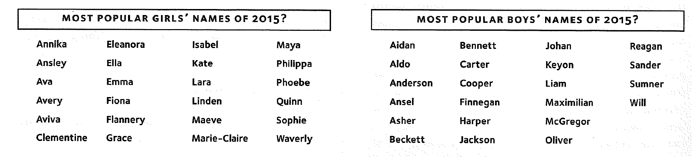

---

### Top 10 names in 2015 and 2004

<br>

```{r, fig.width=7, fig.height=6, echo=F, message=F, results="asis", cache=T}
library(knitr)

df %>% filter(year==2015 & gender=="F") %>% arrange(desc(count)) -> Fdf
head(Fdf, 10) %>% arrange(name) %>% select(name) -> Fdf
df %>% filter(year==2004 & gender=="F") %>% arrange(desc(count)) -> Fdf4
head(Fdf4, 10) %>% arrange(name) %>% select(name) -> Fdf4

df %>% filter(year==2015 & gender=="M") %>% arrange(desc(count)) -> Mdf
head(Mdf, 10) %>% arrange(name) %>% select(name) -> Mdf
df %>% filter(year==2004 & gender=="M") %>% arrange(desc(count)) -> Mdf4
head(Mdf4, 10) %>% arrange(name) %>% select(name) -> Mdf4

kable(data.frame(topFemale2015=Fdf$name, topFemale2004=Fdf4$name, topMale2015=Mdf$name, topMale2004=Mdf4$name))
```

---

## Predicting is hard
There is not much overlap between the prediction and the results for 2015. Just using the 2004 list, you would have made a better prediction.

What you see is that predicting which names in particular will be the most popular is a very difficult task. The Simmel effect describes forces that create observable patterns, but that does not mean that the model is predictive enough to tell us which of all names will become popular ten years from now, even if we had data of the social status of parents. 

This is the difference between explanatory and predictive power of a model. A model can explain phenomena without being useful to make predictions, as in this case, but can also be predictive without giving explanations, like in the case of deep learning or other black-box approaches.

> **Take home message:** understanding does not imply predictive power

---

# Summary

- **Social Impact Theory:** impact grows with the strength, immediacy and number of sources. It grows sublinearly with the number of sources (psychosocial law), and it is divided among targets
- **Online social impact:** on Digg and Twitter, additional exposures from friends have diminishing returns
- **The Simmel effect:** imitation and differentiation make fashions come and go, while social differences persist
- **Collective attention:** trends can have an exogenous or endogenous origin and be critical or sub-critical (endo-exo model, YouTube). Anticipated shocks, with activity building up before an expected event, appear in Twitter hashtags and YouTube videos
- **Baby names:** they follow the dynamics of fashion, but which names become popular is hard to predict. Explaining is not the same as predicting
